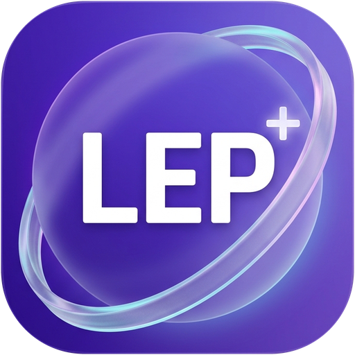
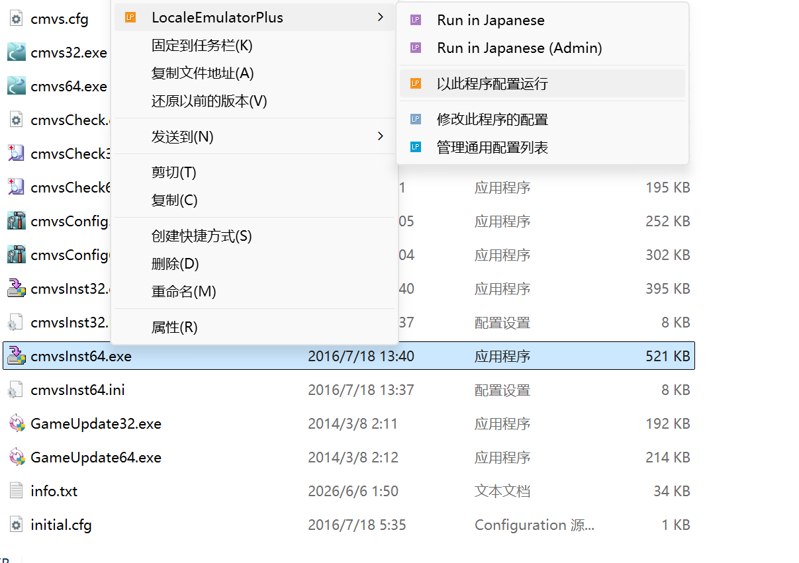
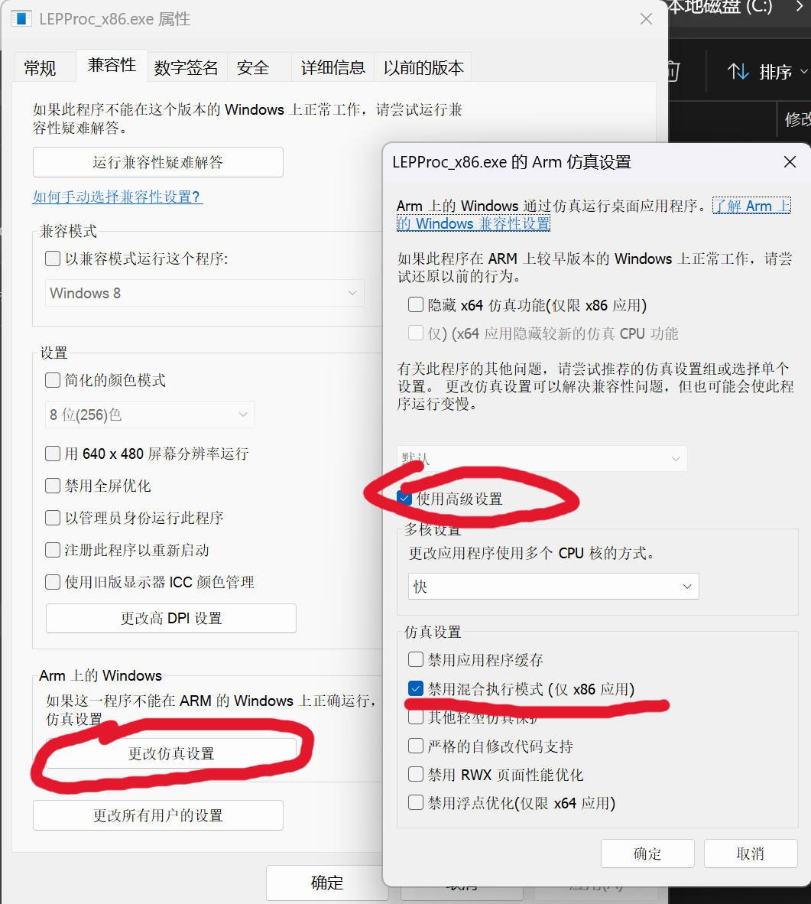

# LocaleEmulatorPlus

[简体中文](README.md) | English



LocaleEmulatorPlus provides per-application locale, code-page, font, and time-zone emulation for Windows programs. Starting with version 3.0.0, it is completely rewritten in **pure native C++23 + Win32** with no .NET runtime dependency, supporting Windows 7 SP1 through Windows 11 (x64). The native process-injection core is maintained in [LocaleEmulatorPlus-Core](https://github.com/julixian/LocaleEmulatorPlus-Core).

This project is derived from the original [Locale Emulator](https://github.com/xupefei/Locale-Emulator) and [Locale Emulator Core](https://github.com/xupefei/Locale-Emulator-Core).

## Features

- **Pure native, zero runtime dependencies**: Built in C++23 + Win32 with statically linked runtime; no .NET Framework needed. Supports 64-bit Windows 7 SP1 – Windows 11 while launching both x64 and x86 target applications.
- **Unified `LEP.exe`**: Combines the GUI (Launch, Global Profiles, Context Menu, Settings) and CLI in a single executable.
- **Windows 11 top-level context menu**: Native `IExplorerCommand` shell extension supporting both classic Explorer menus (Windows 7–10 and Windows 11 "Show more options") and the modern Windows 11 top-level menu via an MSIX Sparse Package.
- **Clear per-application profile workflow**:
  - When no app profile exists, the context menu shows only "Create a profile for this app..."; once created, it dynamically switches to "Run with this app's profile" and "Edit this app's profile...".
  - The profile editor cleanly separates **Save**, **Save & Run**, and **Create Shortcut** — saving never unexpectedly launches the target.
  - When the target lives in a read-only location (e.g. mounted ISO, optical disc, protected folder), LEP prompts to fall back to saving the app profile inside global `config.toml`.
- **TOML configuration**: Human-readable `config.toml` and `<app>.lep.toml`, with built-in Simplified Chinese, English, and Japanese localizations (`locales/*.toml`).
- **Microsoft Store ready**: Automatically detects MSIX packaged execution and stores user config under `%LOCALAPPDATA%\LocaleEmulatorPlus\config.toml`, with Store manifest `packaging/AppxManifest.store.xml`.



> **Note (Windows on ARM)**: When running x86 applications under locale emulation on Windows on ARM, enable "Disable hybrid execution mode" (`禁用混合执行模式`) for both `LEPHelper_x86.exe` and the target x86 executable.



## CLI Usage

```powershell
# Launch an application with a named global profile
LEP.exe run --profile "Run in Japanese" "C:\Games\App.exe" --arg1

# Launch using the application's own .lep.toml or global fallback profile
LEP.exe run "C:\Games\App.exe"

# Open the per-application profile editor
LEP.exe edit "C:\Games\App.exe"

# Create a desktop/folder shortcut launching via LEP
LEP.exe shortcut "C:\Games\App.exe" --profile "Run in Japanese"

# List global profiles
LEP.exe list-profiles

# Install / uninstall Explorer context menu (default: classic current-user; --all-users for all users, --win11 for Win11 sparse menu)
LEP.exe install
LEP.exe uninstall
```

## Repository Layout

- `LEPCommon/`: Shared C++23 modules (TOML configuration, system locale/timezone enumeration, i18n, shortcuts, launcher).
- `LEP/`: Main `LEP.exe` (Win32 GUI, CLI, context-menu & Win11 sparse-package installer).
- `LEPShellExt/`: Native COM `IExplorerCommand` shell extension (`LEPShellExt.dll`).
- `LEPHelper/`: Minimal 32-bit launch bridge (`LEPHelper_x86.exe`) to invoke `LoaderDll_x86.dll` for x86 targets.
- `assets/`: Application icon, manifest, and `locales/*.toml` translations.
- `packaging/`: Win11 sparse package (`AppxManifest.sparse.xml`) and Microsoft Store (`AppxManifest.store.xml`) manifests and visual assets.

## Build

Requirements:

- Windows x64, Python 3.10+
- [mcpp](https://github.com/mcpp-community/mcpp) (manages `llvm@23.1.3` and `julixian.tomlkitpp`)
- Visual Studio with MSVC v143 (`14.44`) sysroot and Windows 10/11 SDK (`makeappx.exe`, `signtool.exe`)
- Prebuilt [LocaleEmulatorPlus-Core](https://github.com/julixian/LocaleEmulatorPlus-Core) DLLs in `../LocaleEmulatorPlus-Core/out/{x86,x64}` (or pass `--core-dir` / `CORE_DIR`)

Build commands:

```powershell
# Build release and portable zip
python .\build.py --profile release --zip

# Also build full Microsoft Store MSIX package
python .\build.py --profile release --store-msix --zip

# Fast development build (no LTO, skip sparse MSIX)
python .\build.py --profile fast-release --skip-sparse
```

Output directory `out/dist/` contains:

- `LEP.exe`
- `LEPShellExt.dll`
- `LEPHelper_x86.exe`
- `LEPShellExt.msix` / `LEPShellExt.cer` (Win11 top-level menu sparse package & certificate)
- `locales/`
- `LoaderDll_x86.dll`, `LoaderDll_x64.dll`, `LocaleEmulatorPlus_x86.dll`, `LocaleEmulatorPlus_x64.dll` (when Core output is present)

## License

Licensed under the [GNU General Public License v3.0](LICENSE.txt) (`GPL-3.0-or-later`).

## Buy me a coffee

Paypal: [paypal.me/julixian](https://www.paypal.com/paypalme/julixian)
