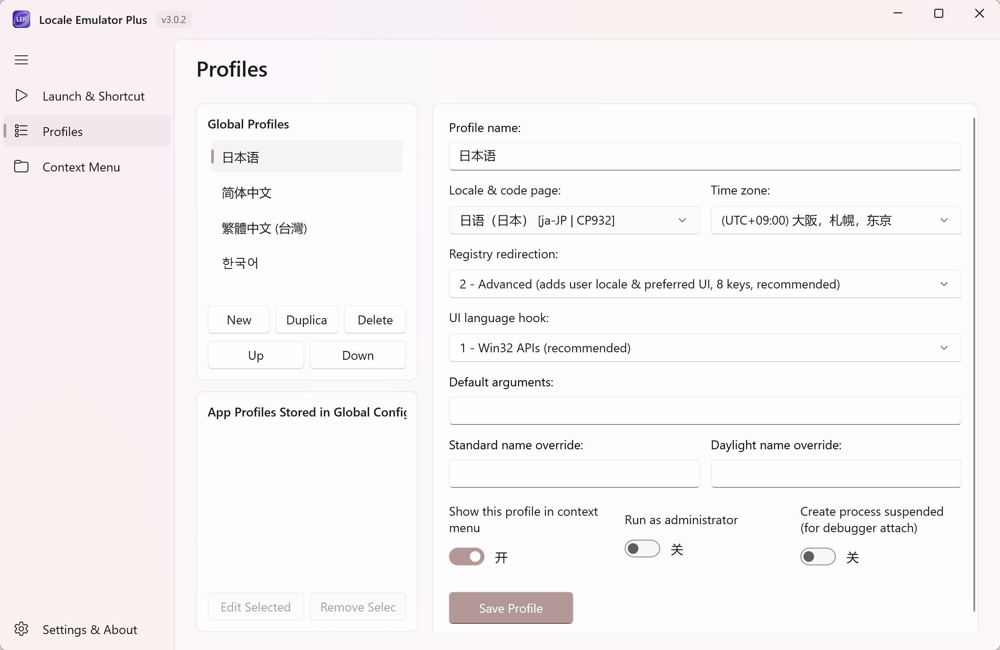
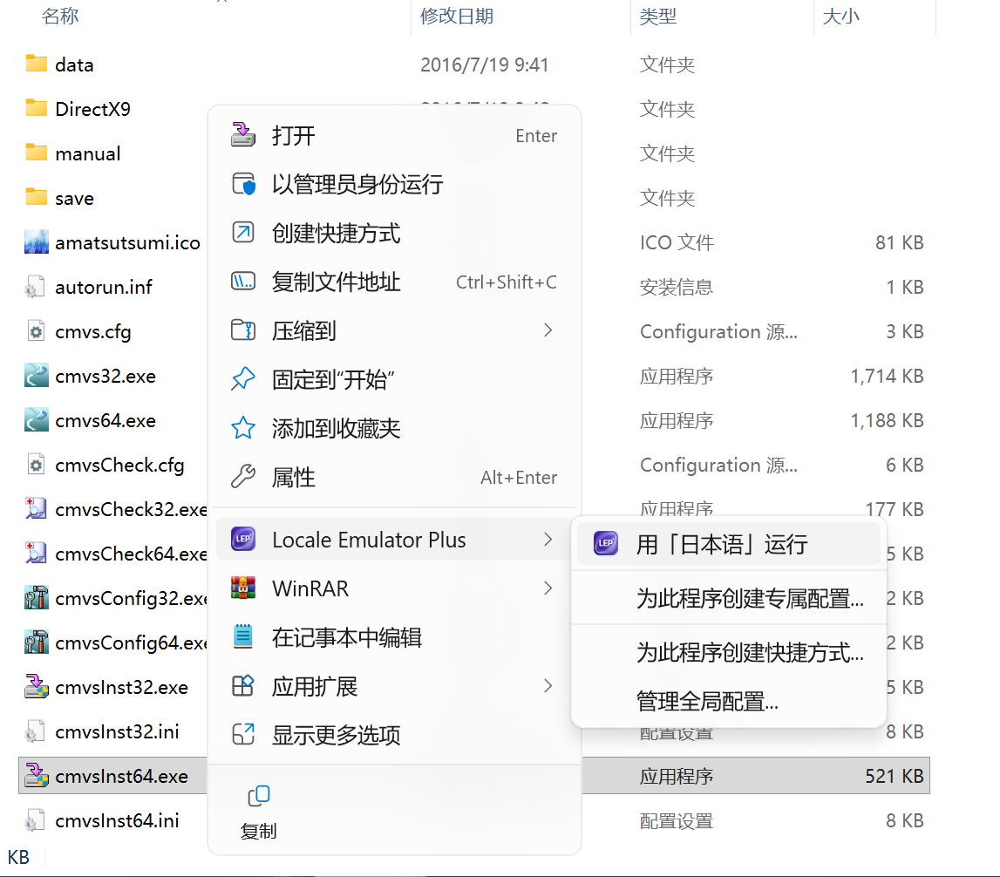
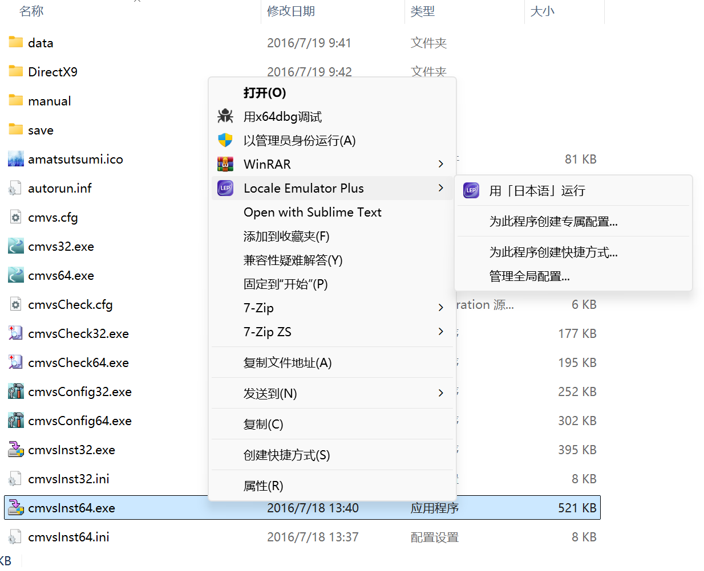

# LocaleEmulatorPlus

[简体中文](README.md) | English


LocaleEmulatorPlus (LEP) is a per-application locale, code-page, font, UI-language, and time-zone emulation launcher for Windows.

Starting with 3.0.0, all legacy .NET Framework components have been replaced with a **pure native C++23** core (`/MT` statically linked, zero runtime dependencies), shipped in three editions: **Microsoft Store (Fluent / WinUI 3)**, **Fluent Portable (WinUI 3)**, and **Native Win32 Portable**. The native injection core lives in [LocaleEmulatorPlus-Core](https://github.com/julixian/LocaleEmulatorPlus-Core).

Derived from the original [Locale Emulator](https://github.com/xupefei/Locale-Emulator) and [Locale Emulator Core](https://github.com/xupefei/Locale-Emulator-Core).

---

## Editions at a Glance

All three editions share the same native components (`LEP.exe` launcher, `LEPShellExt.dll`, `LEPHelper_x86.exe`, Core DLLs), TOML configuration format, and language packs. Launching a target from the context menu always invokes `LEP.exe` directly without starting the WinUI 3 frontend.

| Feature | Microsoft Store (Fluent / WinUI 3) | Fluent Portable (WinUI 3) | Native Portable (Win32) |
| :--- | :--- | :--- | :--- |
| **OS Support** | Windows 10 (2004+) / Windows 11 (x64) | Windows 10 (2004+) / Windows 11 (x64) | Windows 7 SP1 – Windows 11 (x64) |
| **UI & Footprint** | WinUI 3 + Mica backdrop, automatic light/dark | WinUI 3 + Mica, self-contained runtime, ~`67 MB` zip | Pure Win32, ~`1.6 MB` zip, zero dependencies |
| **Win11 Top-Level Menu** | Managed automatically by Microsoft Store | One-click install (bundled MSIX sparse package) | One-click install (bundled MSIX sparse package) |
| **Config Location** | `%LOCALAPPDATA%\Packages\...\LocalState\config.toml` | Alongside `LEPWinUI.exe` (falls back to LocalAppData if read-only) | Alongside `LEP.exe` (falls back to LocalAppData if read-only) |
| **Updates** | Automatic via Microsoft Store | Manual GitHub Releases check in Settings | Manual GitHub Releases check in Settings |

### Screenshots

**WinUI 3 Fluent Edition (Microsoft Store / Fluent Portable)**



**Native Portable Edition (Win32)**


---

## Highlights

- **x64 host, x64 + x86 targets**: Main launcher and shell extension are x64 native; 32-bit applications are bridged seamlessly via the minimal `LEPHelper_x86.exe` helper.
- **Full Explorer context menu coverage (Win7 – Win11)**: Native COM `IExplorerCommand` supporting classic menus and modern Windows 11 top-level menus (including automatic promotion in Windows 11 26H2 *Personalization → Context menu*).
- **Clean per-application profile workflow**:
  - Dynamic context menu: shows only *"Create a profile for this app..."* when none exists, switching to *"Run with this app's profile"* and *"Edit this app's profile..."* once configured.
  - Strictly separated **Save**, **Save & Run**, and **Create Shortcut** actions — saving never unexpectedly launches the target.
  - Read-only media (mounted ISOs / optical drives) prompt to fall back into global `config.toml`; UAC-protected local folders (e.g. `Program Files`) support **in-place elevated write/delete** of `.lep.toml` without closing or restarting the editor.
- **Human-readable TOML & Localization**: `config.toml` and `<app>.lep.toml`, with built-in `zh-CN`, `en-US`, and `ja-JP` language packs (`locales/*.toml`).
- **Sensible defaults**: Registry redirection level 2 (Advanced) and UI language hook level 1 (Win32 APIs), with preset Japanese, Simplified Chinese, Traditional Chinese (Taiwan), and Korean profiles.





> **Note (Windows on ARM)**: When running x86 applications under locale emulation on Windows on ARM, enable *"Disable hybrid execution mode"* (`禁用混合执行模式`) for both `LEPHelper_x86.exe` and the target x86 executable.


---

## CLI Usage

`LEP.exe` serves as both the portable GUI and the full CLI launcher:

```powershell
# Launch with a named global profile (arguments after -- are forwarded to the target)
LEP.exe run --profile "日本语" "C:\Games\App.exe" -- --windowed

# Launch using the app's own .lep.toml / global fallback profile, or first global profile
LEP.exe run "C:\Games\App.exe"

# Open the per-application profile editor
LEP.exe manage "C:\Games\App.exe"

# Create a .lnk shortcut launching through LEP
LEP.exe shortcut "C:\Games\App.exe" --profile "日本语" --out "C:\Users\Me\Desktop\App.lnk"

# List global profiles
LEP.exe list-profiles

# Register / remove context menu (default: classic current user; --all-users; --win11 for sparse package)
LEP.exe install
LEP.exe install --win11
LEP.exe uninstall
```

---

## Repository Layout

- `LEPCommon/`: Shared C++23 modules (TOML config, system locale/timezone enumeration, i18n, shortcuts, launcher).
- `LEP/`: Native `LEP.exe` (Win32 GUI, CLI, WinHTTP GitHub Releases update check, context-menu installer).
- `LEPWinUI/`: Fluent 2 frontend `LEPWinUI.exe` (WinUI 3 + .NET 10 + Mica; shared by Microsoft Store and Fluent Portable editions).
- `LEPShellExt/`: Native COM `IExplorerCommand` shell extension (`LEPShellExt.dll`; runs targets via `LEP.exe` and routes UI actions to `LEPWinUI.exe` when present).
- `LEPHelper/`: Minimal 32-bit launch bridge (`LEPHelper_x86.exe`, imports `kernel32.dll` only) to invoke `LoaderDll_x86.dll`.
- `assets/`: Application icon, PerMonitorV2/LongPath manifest, and `locales/*.toml` translations.
- `packaging/`: Win11 sparse package (`AppxManifest.sparse.xml`), Microsoft Store (`AppxManifest.store.xml`) manifests, and visual assets.

---

## Building from Source

### Requirements

- Windows x64, Python 3.10+
- [mcpp](https://github.com/mcpp-community/mcpp) (manages `llvm@23.1.3` and `julixian.tomlkitpp`)
- Visual Studio with MSVC v143 (`14.44`) sysroot (for Windows 7 compatibility) and Windows 10/11 SDK (`makeappx.exe`, `signtool.exe`)
- .NET 10 SDK (only needed when building WinUI 3 Fluent editions via `--store-msix` / `--fluent-zip`)
- Prebuilt [LocaleEmulatorPlus-Core](https://github.com/julixian/LocaleEmulatorPlus-Core) DLLs in `../LocaleEmulatorPlus-Core/out/{x86,x64}` (or pass `--core-dir` / `CORE_DIR`)

### Commands

```powershell
# Build native portable release (including Win11 sparse package and zip)
python .\build.py --profile release --zip

# Full build: native portable zip + Fluent portable zip + Microsoft Store MSIX
python .\build.py --profile release --store-msix --fluent-zip --zip

# Fast WinUI 3 rebuild reusing existing native binaries
python .\build.py --skip-native --store-msix --fluent-zip

# Fast development build (no LTO, skip sparse package)
python .\build.py --profile fast-release --skip-sparse
```

Outputs:

- `out/dist/`: Ready-to-run native portable directory (`LEP.exe`, `LEPShellExt.dll`, `LEPHelper_x86.exe`, `LEPShellExt.msix`/`.cer`, `Assets/`, `locales/`, and the 4 Core DLLs)
- `out/fluent-dist/`: Ready-to-run Fluent portable directory (`out/dist/` merged with self-contained `LEPWinUI.exe` and runtime)
- `out/LocaleEmulatorPlus-<version>-x64.zip`: Native Win32 portable archive
- `out/LocaleEmulatorPlus-<version>-Fluent-x64.zip`: WinUI 3 Fluent portable archive
- `out/LocaleEmulatorPlus-<version>-x64.msix`: Unsigned Microsoft Store submission package (bundles `LEPWinUI.exe` + full native engine)

---

## License & Privacy

- License: [GNU General Public License v3.0](LICENSE.txt) (`GPL-3.0-or-later`)
- Privacy Policy: [PRIVACY.md](PRIVACY.md) (100% local, zero data collection)

## Buy me a coffee

Paypal: [paypal.me/julixian](https://www.paypal.com/paypalme/julixian)
