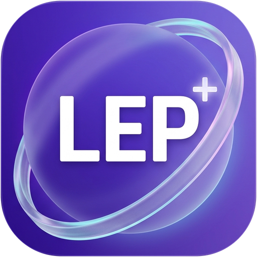
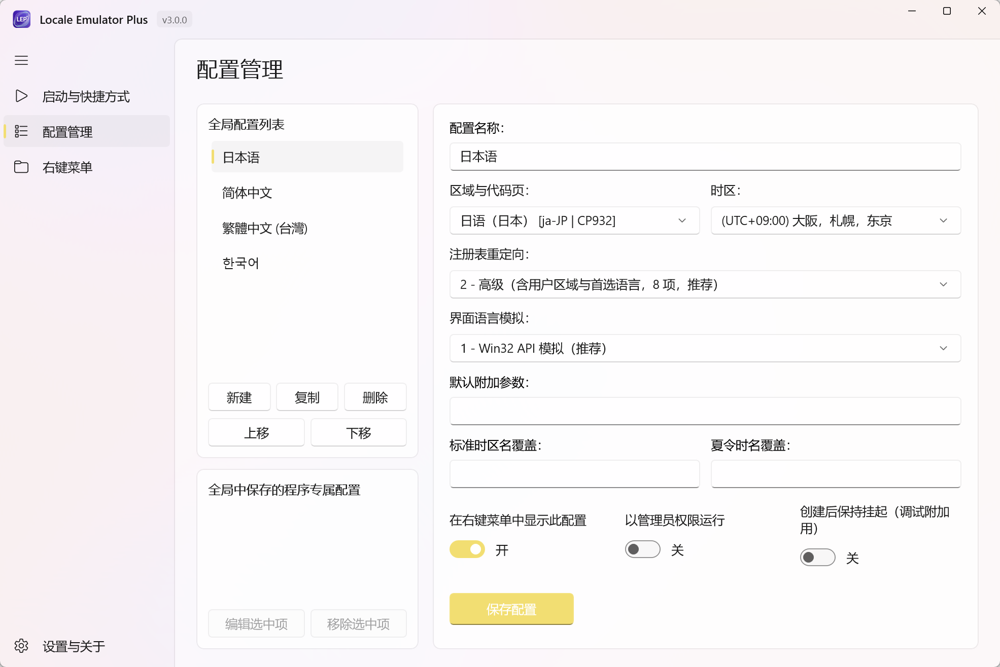
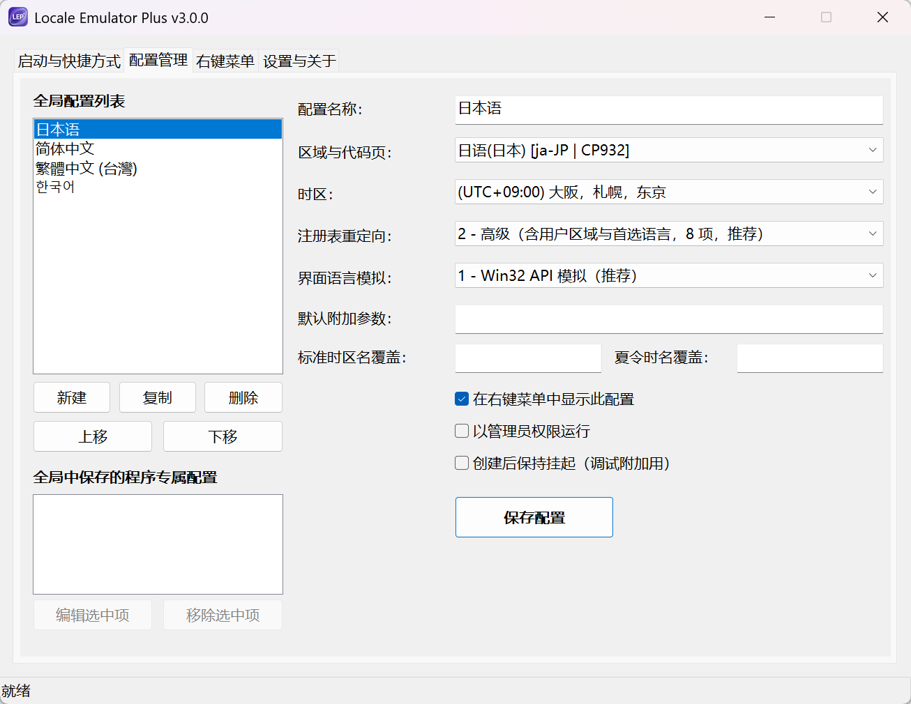
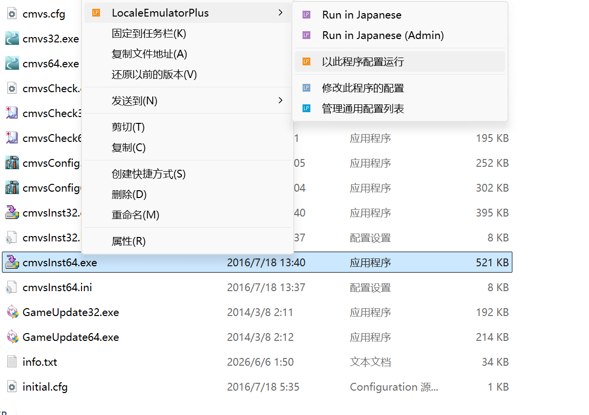
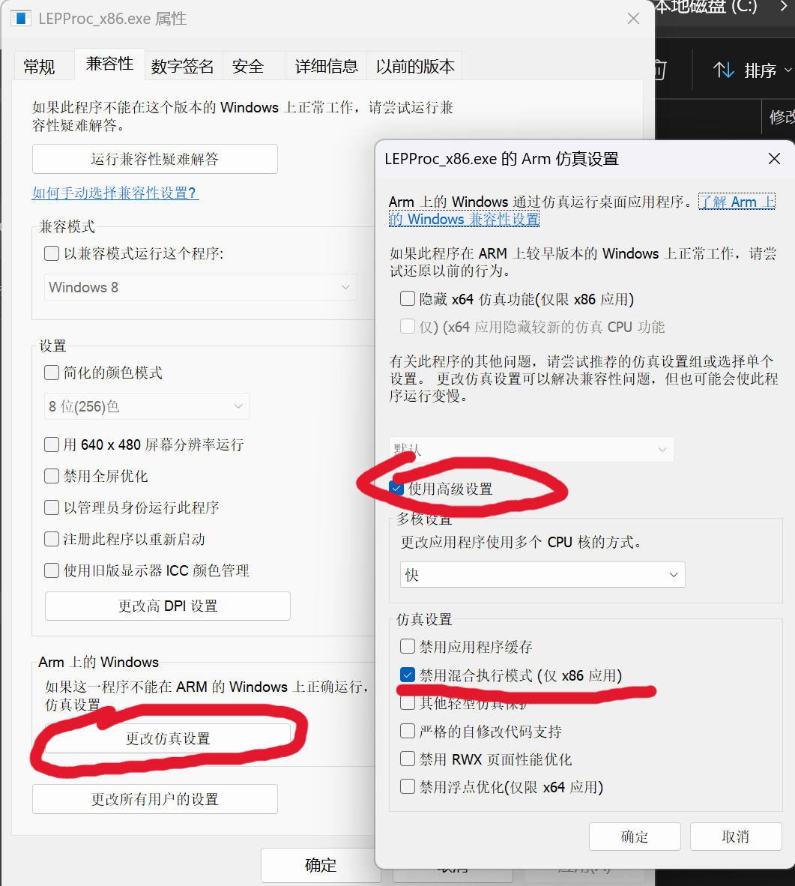

# LocaleEmulatorPlus

简体中文 | [English](README.EN.md)



LocaleEmulatorPlus（LEP）是一款面向 Windows 的按应用区域、代码页、字体、界面语言与时区模拟启动工具。

3.0.0 起彻底告别 .NET Framework 遗留代码，底层重写为**纯原生 C++23**（`/MT` 静态链接、零外部运行库依赖），同时提供 **Microsoft Store Fluent（WinUI 3）** 与 **原生 Win32 便携版** 两种发行形态。原生进程注入核心位于 [LocaleEmulatorPlus-Core](https://github.com/julixian/LocaleEmulatorPlus-Core)。

本项目源自 [Locale Emulator](https://github.com/xupefei/Locale-Emulator) 与 [Locale Emulator Core](https://github.com/xupefei/Locale-Emulator-Core)。

---

## 两种版本怎么选

两版底层共用同一套原生组件（`LEP.exe` 启动器、`LEPShellExt.dll` 右键菜单、`LEPHelper_x86.exe` 32 位桥接器、Core DLL）、同一份 TOML 配置格式和语言包。即使在商店版里，通过右键菜单直接运行程序也是由原生 `LEP.exe` 直接启动，不需要拉起 WinUI 3 界面。

| 对比项 | Microsoft Store 版（Fluent / WinUI 3） | 便携版（原生 Win32） |
| :--- | :--- | :--- |
| **适用系统** | Windows 10 (2004+) / Windows 11 (x64) | Windows 7 SP1 – Windows 11 (x64) |
| **界面** | WinUI 3 + Mica 云母材质，自动跟随深浅色 | 纯原生 Win32，压缩包约 `1.4 MB`，零依赖 |
| **Win11 一级右键菜单** | 安装即自动托管，免证书、免稀疏包 | 一键启用（自动导入公钥并注册 MSIX 稀疏包） |
| **配置文件位置** | `%LOCALAPPDATA%\LocaleEmulatorPlus\config.toml` | 默认程序同目录 `config.toml`（只读时自动回退 LocalAppData） |
| **更新方式** | Microsoft Store 自动更新 | 「设置与关于」内手动检查 GitHub Releases |

### 界面预览

**Microsoft Store 版（WinUI 3 Fluent）**



**便携版（原生 Win32）**



---

## 核心特性

- **x64 主体 + 全架构目标支持**：主程序与 Shell 扩展均为 x64 原生实现，通过极简 32 位桥接器 `LEPHelper_x86.exe` 无缝启动 x86 目标程序。
- **Windows 7 – Windows 11 右键菜单全覆盖**：原生 COM `IExplorerCommand` 实现，支持 Win7/10 经典菜单与 Win11 新版一级右键菜单（含 Windows 11 26H2「个性化 → 上下文菜单」开关自动置顶）。
- **清晰直觉的每程序配置流程**：
  - 右键菜单动态感知目标是否已有专属配置：未创建时仅显示「为此程序创建专属配置...」，创建后自动切换为「使用此程序的专属配置运行」与「编辑此程序的专属配置...」。
  - 编辑器严格分离「保存配置」「保存并运行」「创建快捷方式」，保存不会意外启动目标程序。
  - 目标目录位于只读介质（ISO 镜像、光盘）时提示回退保存到全局 `config.toml`；位于受 UAC 保护的本地目录（如 `Program Files`）时支持**原地按需提权写入/删除** `.lep.toml`，不关闭编辑窗口。
- **TOML 配置与多语言**：使用人类可读的 `config.toml` 与 `<程序>.lep.toml`，内置简体中文、English、日本語语言包（`locales/*.toml`），支持自定义扩展。
- **默认挡位开箱即用**：默认注册表重定向 2 档（高级）、界面语言模拟 1 档（Win32 API 模拟），预置日本语、简体中文、繁體中文 (台灣)、한국어四套配置。



> **提示（Windows on ARM）**：在 Windows on ARM 设备上转区 x86 程序时，需要为 `LEPHelper_x86.exe` 和目标 x86 程序开启「禁用混合执行模式」。



---

## 命令行用法

`LEP.exe` 既是便携版 GUI 入口，也是完整的命令行启动器：

```powershell
# 使用指定全局配置启动程序（支持 -- 透传参数给目标）
LEP.exe run --profile "日本语" "C:\Games\App.exe" -- --windowed

# 按优先级运行（程序专属 .lep.toml / 全局回退配置 > 第一个全局配置）
LEP.exe run "C:\Games\App.exe"

# 打开某程序的专属配置编辑窗口
LEP.exe manage "C:\Games\App.exe"

# 创建指向 LEP 启动目标程序的 .lnk 快捷方式
LEP.exe shortcut "C:\Games\App.exe" --profile "日本语" --out "C:\Users\Me\Desktop\App.lnk"

# 列出所有全局配置
LEP.exe list-profiles

# 注册 / 卸载右键菜单（默认当前用户经典菜单；--all-users 所有用户；--win11 为 Win11 一级稀疏包菜单）
LEP.exe install
LEP.exe install --win11
LEP.exe uninstall
```

---

## 仓库结构

- `LEPCommon/`：共享 C++23 模块（TOML 配置、系统区域/时区枚举、多语言、快捷方式、进程启动器）。
- `LEP/`：原生主程序 `LEP.exe`（Win32 GUI、CLI、WinHTTP GitHub Release 更新检查、右键菜单安装器）。
- `LEPWinUI/`：Microsoft Store 版 Fluent 2 前端 `LEPWinUI.exe`（WinUI 3 + .NET 10 + Mica）。
- `LEPShellExt/`：原生 COM `IExplorerCommand` 右键菜单扩展 `LEPShellExt.dll`（运行直达 `LEP.exe`，UI 自动路由至 `LEPWinUI.exe` 或 `LEP.exe`）。
- `LEPHelper/`：轻量 32 位启动桥接器 `LEPHelper_x86.exe`（仅链接 `kernel32.dll`，负责调用 `LoaderDll_x86.dll`）。
- `assets/`：程序图标、PerMonitorV2 / LongPath 清单与 `locales/*.toml` 语言文件。
- `packaging/`：Win11 稀疏包（`AppxManifest.sparse.xml`）、Microsoft Store（`AppxManifest.store.xml`）清单及图标资产。

---

## 从源码构建

### 环境要求

- Windows x64，Python 3.10+
- [mcpp](https://github.com/mcpp-community/mcpp)（自动管理 `llvm@23.1.3` 工具链与 `julixian.tomlkitpp` 依赖）
- Visual Studio（MSVC v143 / `14.44` sysroot，兼容 Windows 7）及 Windows 10/11 SDK（含 `makeappx.exe`、`signtool.exe`）
- .NET 10 SDK（仅构建 Microsoft Store WinUI 3 Fluent 版 `--store-msix` 时需要）
- 相邻目录的 [LocaleEmulatorPlus-Core](https://github.com/julixian/LocaleEmulatorPlus-Core) 构建产物（`out/x86` 与 `out/x64`），也可通过 `--core-dir` 或 `CORE_DIR` 指定

### 构建命令

```powershell
# 构建原生便携版（含 Win11 稀疏包与便携 zip）
python .\build.py --profile release --zip

# 全量构建：便携版 zip + Microsoft Store WinUI 3 Fluent 版 MSIX
python .\build.py --profile release --store-msix --zip

# 仅修改 LEPWinUI 时，复用已有原生产物快速重打 Store MSIX
python .\build.py --skip-native --store-msix

# 开发期快速构建（跳过 LTO 与稀疏包）
python .\build.py --profile fast-release --skip-sparse
```

主要构建产物：

- `out/dist/`：便携版可直接运行目录（`LEP.exe`、`LEPShellExt.dll`、`LEPHelper_x86.exe`、`LEPShellExt.msix` / `.cer`、`locales/` 及 4 个 Core DLL）
- `out/LocaleEmulatorPlus-3.0.0-x64.zip`：便携版压缩包
- `out/LocaleEmulatorPlus-3.0.0-x64.msix`：Microsoft Store 未签名提交包（含 `LEPWinUI.exe` 与完整原生引擎）

---

## 许可证与隐私

- 开源协议：[GNU General Public License v3.0](LICENSE.txt)（`GPL-3.0-or-later`）
- 隐私政策：[PRIVACY.md](PRIVACY.md)（纯本地运行，不收集任何用户数据）

## 乞讨

从原分支那里继承修复并彻底重写消耗了我大量的精力（和 token orz），如果你愿意大发慈悲帮我回点血，我可以艾特[某位大神](https://github.com/SuQiandYing)或者它的星怒们给你们免费卖屁股()。


Paypal: [paypal.me/julixian](https://www.paypal.com/paypalme/julixian)
